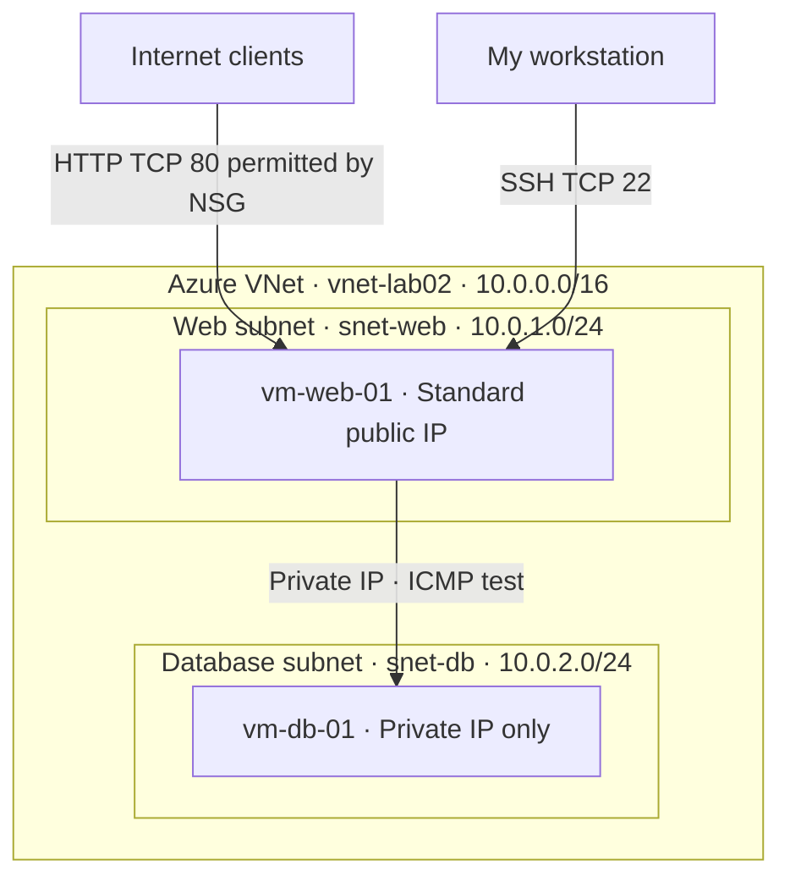

# Lab 02 — Building a Secure Two-Tier Web Application in Azure

I built this Azure lab to model an online store that accepts credit card payments. A customer would visit the public web tier, add items to their cart, and enter their card details on a payment provider's hosted checkout page. The provider would send the payment result to the application, which would save the order, payment status, and transaction reference in the private database. The database would have no public IP.

In the lab, I used a stand-in database VM and verified the private path from the web tier with ICMP. The store and payment flow are examples of how the architecture could be used.

[](https://www.loom.com/share/672b368e69c94beab0f231891023597b)

## Architecture



The diagram shows the lab's configured entry point and the path I tested. HTTP was allowed in the NSG. The exercise focused on networking, so the validation below uses SSH and ping.

## Prerequisites

- An active Azure subscription
- An SSH client and a terminal

## Deployment settings

| Setting | Value |
| --- | --- |
| Resource group | `rg-lab02-Ricky` |
| Region | East US |
| Virtual network | `vnet-lab02` · `10.0.0.0/16` |
| Web subnet | `snet-web` · `10.0.1.0/24` |
| Database subnet | `snet-db` · `10.0.2.0/24` |
| VM image | Ubuntu Server 20.04 LTS |
| VM size | `F1as_v7` for both VMs |
| SSH user and key | `azureuser` · `key-lab02` |

## Build and validate

1. **Create the virtual network.** In the Azure portal, I created `vnet-lab02` in `rg-lab02-Ricky` and added the two subnets listed above.
2. **Deploy the web VM.** I created `vm-web-01` on `snet-web`, assigned a Standard public IP, and allowed inbound HTTP (TCP 80) and SSH (TCP 22) for the lab. I created `key-lab02` and downloaded the private key to my workstation.
3. **Deploy the database-tier VM.** I created `vm-db-01` on `snet-db`, reused the SSH public key stored in Azure, and set **Public IP** to **None**. The lab configuration included a TCP 22 rule on the database-tier NSG. The VM was reachable only through a network path to its private IP.
4. **Test the private path.** I copied the actual private IP from the database VM's overview page and connected to the web VM. From the web VM, I ran a four-packet ping to the database tier. The example uses `10.0.2.4`.

From my workstation:

```bash
ssh -i key-lab02.pem azureuser@<web-public-ip>
```

From the web VM:

```bash
ping -c 4 10.0.2.4
```

A successful ping confirms IP reachability from web to database tier. A database connectivity test would require a service listening on the database port.

## Database-tier network rules

I opened the database VM's network security group (NSG) and added this inbound rule.

| Priority | Rule | Source | Source ports | Destination | Destination ports | Protocol | Action |
| --- | --- | --- | --- | --- | --- | --- | --- |
| 100 | `Allow-Web-Subnet` | `10.0.1.0/24` | Any | Any | Any | Any | Allow |

This rule allows the entire web subnet. Azure's default `AllowVNetInBound` rule at priority 65000 can still permit traffic from other sources covered by the `VirtualNetwork` service tag. To enforce my web-VM-only goal for database traffic, I would replace the broad allow with a rule scoped to the web VM's private IP and the database service's TCP port. I would add an explicit deny for remaining inbound traffic to the database VM ahead of the default rules, with any required management access handled by a separate, narrowly scoped rule. [Azure NSG rule evaluation](https://learn.microsoft.com/azure/networking/design-guide/network-application-security-groups)

## How the design relates to PCI DSS v4.0.1

| Requirement | How I would apply it |
| --- | --- |
| **1.4.4 — Prevent direct access to stored cardholder data from untrusted networks** | The private database tier illustrates where I would place a system that stores cardholder data. I would document the actual cardholder data flows and verify that the network controls prevent direct access from untrusted networks. The lab database VM served as a stand-in. |
| **11.4.5 — Validate segmentation used to isolate the cardholder data environment** | If I relied on this segmentation to isolate the cardholder data environment (CDE) from out-of-scope systems, a qualified, organizationally independent tester would need to verify isolation at least every 12 months and after changes to segmentation controls or methods. My web-to-database ping only checks the permitted path. I would also verify that the database port is blocked from networks intended to be out of scope. |

## Troubleshooting

- **Ping times out.** I check the database VM's private IP, confirm that both VMs are in the same VNet, and review the effective NSG rules on both tiers.
- **SSH to the web VM fails.** I check the web VM's public IP, TCP 22 rule, username, and local key. To administer the database VM from my workstation, I would use an approved private access path and keep my private key on my workstation.

## Cleanup

After testing, I can remove the lab by deleting `rg-lab02-Ricky` in the Azure portal. Deleting the resource group removes the resources it contains.
